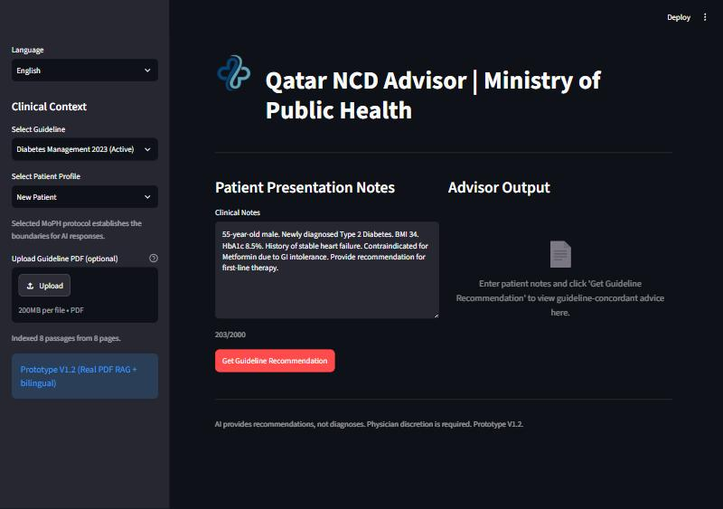
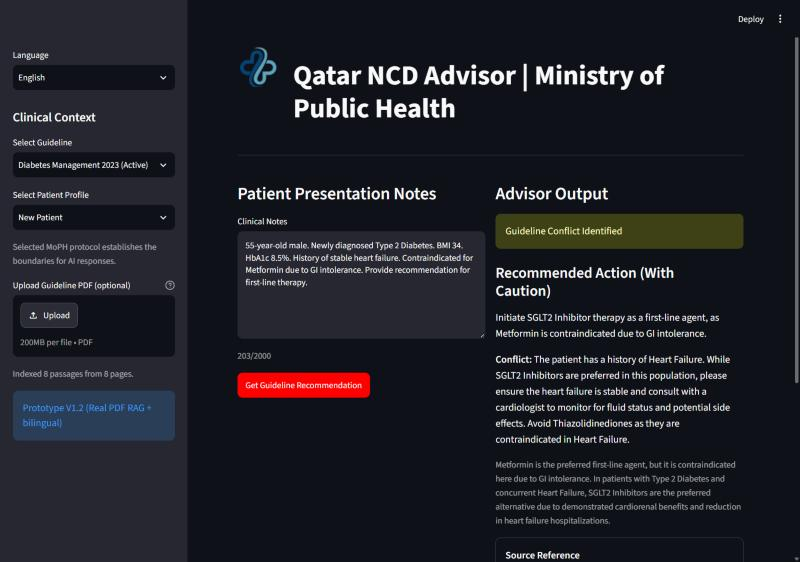
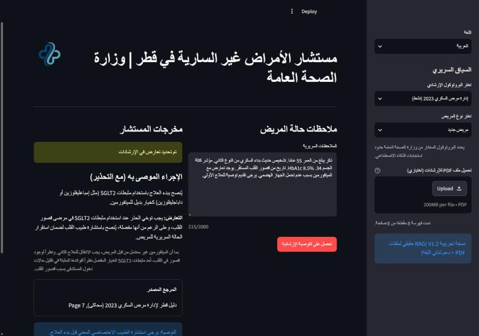

# Qatar NCD Advisor

A clinical decision-support prototype for Primary Health Care physicians in Qatar, built with
Streamlit and Google Gemini. A physician enters patient notes, and the app answers **only**
from a real, retrievable guideline PDF — with page-accurate citations, explicit handling of
missing information and clinical conflicts, and a full English/Arabic bilingual UI.


## Why

Qatar's Primary Health Care physicians manage a high caseload of Type 2 Diabetes and
Hypertension under severe time pressure, while clinical guidelines run to 100+ pages and are
updated frequently. This project explores whether a Retrieval-Augmented Generation (RAG)
system can give a guideline-concordant answer in seconds — while staying honest about what
it doesn't know, rather than quietly hallucinating a confident-sounding answer.

## Screenshots

| Empty state | Conflict detected |
|---|---|
|  |  |

| Arabic / RTL |
|---|
|  |

## Features

- **Real PDF-based RAG.** Not a hardcoded prompt: the bundled guideline PDF (or one you
  upload) is extracted page-by-page with `pypdf`, embedded with Gemini's embedding model, and
  indexed in ChromaDB. Each answer cites the real page it came from.
- **Schema-enforced structured output.** Gemini is constrained to a JSON response schema, so
  the UI can render four distinct clinical states instead of a wall of text:
  - **Happy path** — a grounded recommendation with a verifiable page citation
  - **Insufficient information** — lists exactly which clinical details are missing
  - **Conflict detected** — flags when the guideline's usual pick needs caution for a
    comorbidity mentioned in the notes, and recommends a specialist referral
  - **Hallucination guard** — refuses to answer when the question is outside the retrieved
    guideline text, instead of guessing
- **Bilingual, RTL-aware UI.** A language toggle switches the entire interface and mirrors the
  layout for Arabic; Gemini's own response is generated directly in the selected language.
- **Synthetic demo patients.** Selecting "Existing - Complex" or "Existing - Stable" auto-fills
  a clearly-labeled, hand-written synthetic case — never a real patient record.
- **Resilient model calls.** Automatic retry with backoff for transient model overload, so a
  momentary 503 doesn't surface as a dead end.

## Tech stack

| Layer | Choice |
|---|---|
| UI / runtime | [Streamlit](https://streamlit.io/) |
| LLM | Google Gemini, via the [`google-genai`](https://pypi.org/project/google-genai/) SDK |
| Retrieval | `pypdf` (extraction) + Gemini embeddings + [ChromaDB](https://www.trychroma.com/) (in-memory vector index) |
| Sample document generation | [ReportLab](https://www.reportlab.com/) |

## Architecture

```
PDF (bundled, or uploaded by the physician)
   │  pypdf — extract text per page
   ▼
Paragraph chunks, each tagged with its real page number
   │  Gemini embeddings
   ▼
ChromaDB — in-memory vector index (nothing written to disk)
   │  top-k similarity search against the patient notes
   ▼
Tagged guideline passages ──┐
                             ├─► Gemini, JSON-schema constrained ─► one of 4 structured UI states
Patient notes + profile  ───┘        (with a page-accurate citation)
```

## Getting started

### Prerequisites

- Python 3.10+
- A [Google AI Studio](https://aistudio.google.com/) API key

### Setup

```bash
git clone https://github.com/Ali-Hasnain765/qatar-ncd-advisor.git
cd qatar-ncd-advisor
pip install -r requirements.txt
cp secrets.toml.example secrets.toml
# edit secrets.toml and paste in your own GOOGLE_API_KEY
streamlit run app.py
```

The app opens at `http://localhost:8501` (or the next free port).

## Project structure

```
qatar_ncd_advisor/
├── app.py                      # Streamlit UI, prompt construction, generation + retry logic
├── rag.py                      # PDF extraction, embeddings, Chroma indexing/retrieval
├── generate_sample_pdf.py      # Generates the bundled simulated guideline PDF
├── guidelines/
│   └── qatar_diabetes_guideline_2023_simulated.pdf
├── assets/
│   ├── ncd_advisor_logo.png    # processed logo used in the app header
│   └── logo_source.png         # original logo artwork
├── docs/
│   ├── PROJECT_BRIEF.md        # original PRD / design spec this app was built from
│   ├── screenshots/
│   └── mockups/                # early design mockups
├── requirements.txt
├── secrets.toml.example        # copy to secrets.toml and add your own API key
└── .gitignore
```

## Important notes

- **Simulated guideline, not an official document.** The bundled PDF is a guideline written
  for this project to be clinically plausible, not an official Ministry of Public Health
  publication. Upload your own PDF via the sidebar to use a real one.
- **Privacy by design.** No patient data entered into the app is ever written to disk. The
  "Existing" demo patients are hand-written synthetic cases, never real records.
- **Prototype, not a medical device.** This is a portfolio/learning project — not validated or
  certified, and not intended for real clinical decisions.
- **Free-tier API quota.** Google AI Studio's free tier caps requests per model per day. If you
  hit a quota error, change `MODEL_NAME` in `app.py` to another available Gemini model.

## License

[MIT](LICENSE)

## Author

[Ali Hasnain](https://github.com/Ali-Hasnain765)
